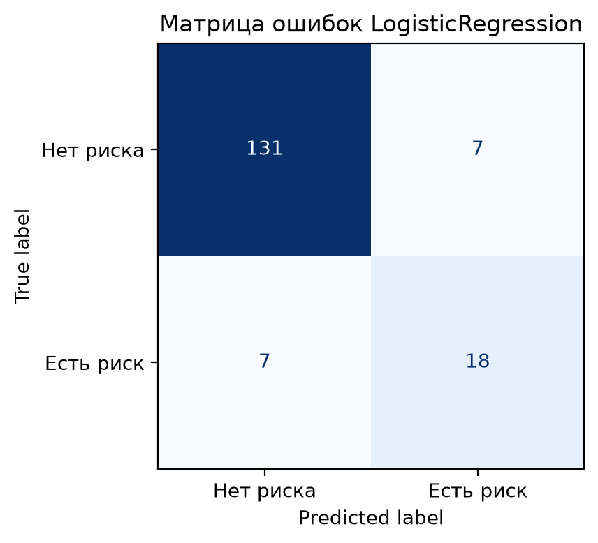
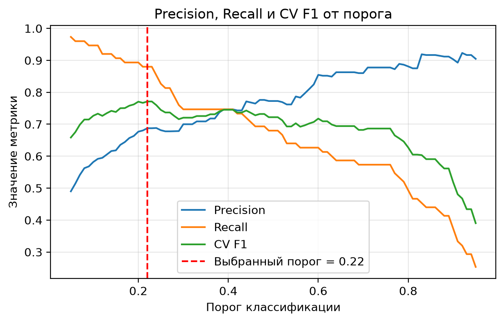

# 📝тап 4. Классификация академических рисков (ЛР9)

## 4.1. Цель и задачи

**Цель:** разработать модель бинарной классификации для выявления учащихся с риском неудовлетворительного итогового результата.

**Задачи:**
1. Определить бинарную целевую переменную.
2. Обучить DummyClassifier и LogisticRegression.
3. Построить матрицу ошибок.
4. Рассчитать precision, recall и F1.
5. Подобрать порог классификации.
6. Сравнить модели и зафиксировать эксперименты в Git.

## 4.2. Целевая переменная

Целевая переменная `at_risk` построена на основе итоговой оценки `G3`:

- `at_risk = 1`, если G3 < 10 — учащийся в группе риска.
- `at_risk = 0`, если G3 >= 10 — учащийся не в группе риска.

Признак G3 исключён из входных данных для предотвращения утечки целевой переменной.

### Распределение данных

| Показатель | Значение |
|---|---:|
| Всего наблюдений | 649 |
| Без риска | 549 |
| Группа риска | 100 |
| Обучающая выборка | 486 |
| Тестовая выборка | 163 |
| test_size | 0.25 |
| random_state | 42 |

Разделение выполнено со стратификацией по целевому классу.

## 4.3. П1. Базовая модель классификации

Обучены две модели: DummyClassifier и LogisticRegression.

Предобработка числовых и категориальных признаков реализована внутри Pipeline.

### Результаты кросс-валидации

| Модель | CV Accuracy | CV F1 | CV ROC-AUC |
|---|---:|---:|---:|
| DummyClassifier | 0.8457 | 0.0000 | 0.5000 |
| LogisticRegression | 0.9198 | 0.7220 | 0.9663 |

### Вывод

DummyClassifier показал высокую Accuracy из-за преобладания класса 0, однако не обнаружил учащихся из группы риска.

LogisticRegression достигла CV F1 = 0.7220 и CV ROC-AUC = 0.9663, значительно превысив показатели константной модели.

Поэтому LogisticRegression выбрана в качестве базового классификатора для последующих экспериментов.

### 📊 Метрики базовой модели

| Метрика | Значение |
|---|---:|
| CV F1 | 0.7220 |
| CV ROC-AUC | 0.9663 |
| Test Accuracy | 0.9141 |
| Test Precision | 0.7200 |
| Test Recall | 0.7200 |
| Test F1 | 0.7200 |
| Test ROC-AUC | 0.9351 |

### 📝 Вывод

Базовая LogisticRegression достигла CV F1 = 0.7220 и CV ROC-AUC = 0.9663.

Код, параметры и метрики модели подготовлены для хранения в Git. Это обеспечивает воспроизводимость обучения и сравнение результатов последующих экспериментов.

## 4.4. П2. Матрица ошибок и метрики классификации

Для оценки LogisticRegression построена матрица ошибок на тестовой выборке из 163 учащихся.

### 📊 Матрица ошибок

| Фактический класс | Прогноз 0 | Прогноз 1 |
|---|---:|---:|
| Нет риска (0) | 131 (TN) | 7 (FP) |
| Есть риск (1) | 7 (FN) | 18 (TP) |

### Ручной расчёт метрик

**Precision:**

Precision = TP / (TP + FP) = 18 / 25 = 0.7200

**Recall:**

Recall = TP / (TP + FN) = 18 / 25 = 0.7200

**F1-score:**

F1 = 2 × Precision × Recall / (Precision + Recall) = 0.7200

### 📊 Результаты

| Метрика | Значение |
|---|---:|
| Accuracy | 0.9141 |
| Precision (класс 1) | 0.7200 |
| Recall (класс 1) | 0.7200 |
| F1 (класс 1) | 0.7200 |
| ROC-AUC | 0.9351 |

### 📝 Вывод

Из 25 учащихся группы риска модель правильно определила 18, но не выявила 7 учащихся (FN).

Также модель ошибочно отнесла 7 учащихся к группе риска (FP).

Для образовательной организации ошибка FN более критична, поскольку учащийся с реальным академическим риском может не получить своевременную поддержку.

Несмотря на Accuracy = 0.9141, Recall для группы риска составляет 0.72. Поэтому необходимо исследовать изменение порога классификации для уменьшения числа пропущенных учащихся.

## 4.5. П3. Выбор порога классификации

Для повышения качества выявления учащихся группы риска исследовано влияние порога классификации на Precision, Recall и F1.

Вероятности положительного класса получены с помощью `cross_val_predict()` на обучающей выборке с 5-кратной стратифицированной кросс-валидацией.

Исследованы пороги от 0.05 до 0.95 с шагом 0.01.

Поскольку пропуск учащегося из группы риска (FN) является более критичной ошибкой, установлено требование Recall ≥ 0.80. Среди подходящих порогов выбран вариант с максимальным средним CV F1.

### 📊 Результаты

| Порог | Precision | Recall | CV F1 |
|---|---:|---:|---:|
| 0.20 | 0.6768 | 0.8933 | 0.7706 |
| **0.22** | **0.6875** | **0.8800** | **0.7712** |
| 0.30 | 0.7000 | 0.7467 | 0.7205 |
| 0.50 | 0.7727 | 0.6800 | 0.7220 |

### 📈 График зависимости метрик от порога

### 📝 Вывод

При уменьшении порога с 0.50 до 0.22 полнота выявления учащихся группы риска увеличилась с 0.6800 до 0.8800.

Средний CV F1 повысился с 0.7220 до 0.7712.

При этом Precision снизился с 0.7727 до 0.6875, то есть число ложных тревог увеличилось.

Выбран порог **0.22**, поскольку для образовательной организации выявление максимального количества учащихся с академическим риском важнее уменьшения числа ложных предупреждений.

Подбор порога проведён без использования тестовой выборки.
